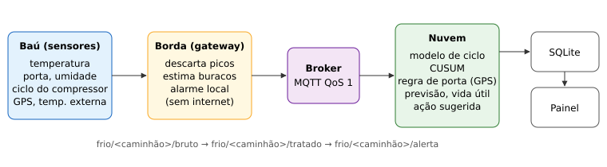

# Cadeia do frio: monitoramento com IoT e IA

Projeto final de Internet das Coisas e Aplicações de IA (Big Data), Unisinos, 2026/2.

Este trabalho desenvolve uma solução funcional para monitorar caminhões refrigerados e detectar falhas na refrigeração antes que a carga saia da faixa de temperatura, usando os sensores do baú e um modelo que aprende o comportamento normal do compressor.

Vacinas, laticínios e carnes viajam dentro de uma faixa de temperatura estreita. Quando a carga passa muito tempo fora dessa faixa, ela é descartada, e no caso de medicamentos o risco chega ao paciente. O monitoramento comum é um alarme de limite: ele dispara quando a temperatura passa do máximo, ou seja, quando a carga já está sendo danificada. Pior, ele toca a cada entrega, porque abrir a porta esquenta o baú por alguns minutos. Quem recebe alarme falso todo dia aprende a ignorá-lo.

A ideia aqui é avisar antes. Um compressor que começa a falhar não deixa a temperatura subir de imediato: o termostato compensa, mantendo-o ligado mais tempo. Essa mudança no ciclo do compressor aparece horas antes da temperatura. O modelo aprende o ciclo normal para cada situação de calor e percebe quando o compressor passa a trabalhar além do esperado.

## Arquitetura

Os dados saem dos sensores do caminhão, passam pela borda e por um broker MQTT e chegam à nuvem, que analisa as leituras e mostra o resultado no painel.



## Componentes

A tabela abaixo resume cada módulo do projeto e sua responsabilidade:

| Peça | Arquivo | O que faz |
|---|---|---|
| Simulador | `src/frio/simulador.py` | Frota de baús com física térmica simples, rotas reais no RS, entregas com porta aberta e falhas injetadas (compressor perdendo eficiência, porta mal fechada, picos e buracos do sensor) |
| Borda | `src/frio/borda.py` | Gateway do caminhão: descarta picos, estima leituras ausentes por até 10 min e liga o alarme local, que funciona sem internet |
| Modelo | `src/frio/modelo.py` | Gradient boosting que prevê o ciclo normal do compressor a partir da temperatura externa, da porta e do desvio do setpoint |
| Monitor | `src/frio/monitor.py` | Na nuvem, minuto a minuto: CUSUM sobre o excesso de ciclo, porta aberta fora de ponto de entrega (GPS), previsão de quando a carga sai da faixa e vida útil restante (Q10) |
| Decisão | `src/frio/decisao.py` | Ação sugerida para cada alerta, com o centro de distribuição mais próximo |
| MQTT | `src/frio/servicos.py` | Simulador, borda e nuvem conversando pelo broker (Mosquitto, QoS 1) e gravando no SQLite |
| Painel | `src/frio/painel.py` | Streamlit: mapa da frota, situação de cada caminhão, alertas com ação e gráficos da viagem |
| Avaliação | `src/frio/avaliacao.py` | 200 viagens de teste com gabarito, comparando a IA com o alarme de limite fixo |

## Requisitos

- Python 3.12 ou superior
- [uv](https://docs.astral.sh/uv/) (gerenciador de dependências)
- Docker (necessário apenas para o broker MQTT)

## Instalação

Instala as dependências do projeto:

```bash
uv sync
```

## Execução

Treina o modelo de ciclo do compressor com 40 viagens normais:

```bash
uv run frio treinar
```

Roda a avaliação com 200 viagens de teste e grava os resultados em `saida/`:

```bash
uv run frio avaliar
```

Executa os testes automatizados:

```bash
uv run pytest
```

Para rodar o pipeline completo em tempo real, suba o broker MQTT com o Docker e inicie a simulação da frota:

```bash
docker compose up -d
uv run frio demo --velocidade 5
```

Em outro terminal, abra o painel de acompanhamento em `http://localhost:8501`:

```bash
uv run frio painel
```

A demo roda quatro caminhões: o IOT-1021 com o compressor falhando, o IOT-2087 com a porta mal fechada e dois normais. Os serviços também sobem separados (`frio simular`, `frio borda`, `frio nuvem`), com `--host` apontando para outro broker.

## Resultados

As 200 viagens de teste se dividem em 80 normais, 70 com falha de compressor e 50 com porta mal fechada. Em cada cenário, comparamos a IA com dois alarmes de limite fixo: o simples, que dispara assim que a temperatura passa do máximo, e um que ignora os 15 minutos após cada abertura de porta.

| Cenário | Métrica | Esperado | IA | Limite fixo | Limite que ignora entregas |
|---|---|---|---|---|---|
| Viagens normais (80) | Viagens com alarme falso | 0 | 0 | 18 | 0 |
| Falha de compressor (70) | Falhas detectadas | 70 | 70 | 69 | 66 |
| Falha de compressor (70) | Avisou antes de sair da faixa (de 66) | 66 | 65 | 63 (1) | 3 |
| Falha de compressor (70) | Antecedência mediana | quanto maior | 124 min | 19 min (1) | 0 min |
| Porta mal fechada (50) | Detectadas | 50 | 50 | 50 | 26 |
| Porta mal fechada (50) | Atraso mediano | quanto menor | 2 min | 7 min | 48 min |

Em 3 das 50 viagens de porta mal fechada a IA também gerou um alerta de compressor depois de a porta fechar. Foi o único tipo de alerta trocado no conjunto de teste.

(1) O limite fixo só "avisa antes" porque toca nas aberturas de porta das entregas, as mesmas que geram os 18 alarmes falsos. Quem recebe esse alarme não tem como saber se é entrega ou compressor.

## Limites

Os dados são simulados, e a física do baú é simples. O sinal que torna a detecção possível é o ciclo do compressor. Nem todo equipamento de refrigeração informa esse dado, em um baú real ele viria do controlador do equipamento ou de um sensor de corrente no compressor.
